<div align="center">

# 🏦 НТ-Банк

### Учебный интернет-банк для практики нагрузочного тестирования

Современная замена WebTours: веб-интерфейс и REST API, асинхронные переводы через Kafka,
внешний сервис, метрики в Grafana и **12 встроенных дефектов**, которые включаются одной кнопкой
прямо под нагрузкой.


[Возможности](#-возможности) ·
[Скриншоты](#-скриншоты) ·
[Быстрый старт](#-быстрый-старт) ·
[Архитектура](#-архитектура) ·
[Первый тест](#-первый-тест-за-15-минут) ·
[Документация](#-подробная-документация)

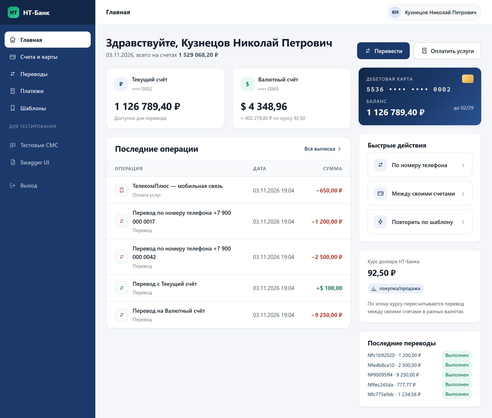

</div>

> Банк, логотип, клиенты, услуги и суммы вымышлены. Совпадения с реальными организациями случайны.

---

## 💡 Зачем это всё

Классический учебный стенд для нагрузочного тестирования — WebTours: простой, старый и предсказуемый.
На реальных проектах всё иначе: CSRF-токены, JWT, одноразовые коды из СМС, асинхронные статусы,
внешние сервисы, очереди и графики, по которым ищут узкое место. НТ-Банк собран именно под это —
от первой записи рекордером до поиска утечки памяти в часовом тесте.

| | WebTours | НТ-Банк |
|---|---|---|
| Веб-интерфейс на обычных HTML-формах | ✅ | ✅ современный, адаптивный |
| REST API с JWT и `Idempotency-Key` | — | ✅ |
| Корреляция: CSRF, id, одноразовый код из «СМС» | частично | ✅ |
| Асинхронная обработка и опрос статуса (While Controller) | — | ✅ Kafka, 1–5 секунд |
| Внешняя зависимость, которую можно «уронить» | — | ✅ сервис «Антифрод» |
| Метрики приложения рядом с метриками JMeter | — | ✅ Prometheus + Grafana + InfluxDB |
| Встроенные дефекты для поиска узких мест | — | ✅ 12 штук, включаются на лету |

---

## ✨ Возможности

### Интернет-банк

- **Вход и регистрация.** При регистрации сразу открываются рублёвый и долларовый счета и карта.
- **Главная:** счета и карта с балансами, последние операции, быстрые действия.
- **Выписка** с фильтром по датам, сортировкой и пагинацией через параметр `page`.
- **Перевод между своими счетами** с конвертацией по курсу.
- **Перевод по номеру телефона** — главный сценарий: черновик → код подтверждения из «СМС» →
  асинхронная проверка в «Антифроде» через Kafka → статус «Выполнен» или «Отклонён» через 1–5 секунд.
- **Оплата услуг:** каталог из 100 услуг с поиском, шаблоны платежей и повтор в один клик.
- **«Тестовые СМС»** — страница в виде экрана телефона, где видны коды подтверждения.
- Работает **без обязательного JavaScript**: рекордер JMeter записывает обычные HTTP-запросы.
  Корректно выглядит на экранах от 360 до 1920 px.

### REST API

- `/api/v1/...` — вход по **JWT** (access-токен на 15 минут и refresh-токен), счета, выписка,
  переводы, платежи, шаблоны.
- Заголовок **`Idempotency-Key`**: повтор запроса не создаёт вторую операцию — даже если запросы
  пришли одновременно.
- Единый формат ошибок с полем `code`: 400, 401, 403, 404, 405, 409, 415, 429, 500.
- **Swagger UI** по адресу `/swagger-ui`.

### Режим «Дефекты» — поломки по кнопке

| Дефект | Что увидите под нагрузкой |
|---|---|
| Задержка ответа | растут время отклика и перцентили |
| Ошибки 500 | растёт доля ошибок |
| Медленный SQL: нет индекса / N+1 / тяжёлое вычисление | падает пропускная способность выписки, база читает миллионы строк |
| Утечка памяти | heap растёт, сборки мусора учащаются, в конце — OutOfMemoryError и перезапуск |
| Нагрузка на CPU | процессор в полке, медленно всё сразу |
| Маленький пул соединений к БД | очередь за соединениями, таймауты |
| Маленький пул потоков Tomcat | очередь перед приложением — закон Литтла вживую |
| Тормозит «Антифрод» | переводы дольше висят «В обработке» или отклоняются |
| Пауза и медленный консьюмер Kafka | растёт лаг, статусы не обновляются |
| Ограничение частоты запросов | ответы 429 с `Retry-After` |

Все настройки применяются сразу, без перезапуска; есть кнопка «Выключить всё» и REST-аналог
`/api/admin/chaos`. Каждый дефект проверен: он действительно заметен на дашборде Grafana.

### Мониторинг

- **Prometheus + Grafana** с готовым дашбордом «НТ-Банк»: RPS и p50/p95/p99 по эндпоинтам,
  ошибки по кодам, JVM и сборки мусора, пулы HikariCP и Tomcat, Kafka и лаг консьюмера,
  переводы по статусам, работа PostgreSQL — и шкала включённых дефектов.
- **InfluxDB 1.8** и дашборд «JMeter + НТ-Банк» для Backend Listener: метрики теста и приложения
  на одном экране.
- Всё настраивается автоматически при запуске — ничего не нужно кликать руками.

### Тестовые данные

- 1000 клиентов `user0001` … `user1000` с паролем `Passw0rd!`, у каждого 50–200 операций в истории.
- Готовый `test-data/users.csv` для CSV Data Set Config.
- Сброс данных за 3 секунды — кнопкой в админке или `POST /api/dev/reset`, даже во время теста.
- Наращивание истории до миллионов операций — чтобы «Нет индекса» было заметно.

### Стенд проверен на прочность

Сам стенд не должен быть источником ошибок, поэтому он прошёл длинную серию проверок:
десятки тысяч параллельных операций со сверкой балансов до копейки, одновременные двойные
подтверждения и повторы с одним ключом, остановка Kafka, «Антифрода» и PostgreSQL, запуск с нуля
на пустых томах, часовой тест надёжности под JMeter. Скрипты проверок лежат в `tools/` —
их можно запустить самому.

---

## 📸 Скриншоты

<table>
  <tr>
    <td width="50%">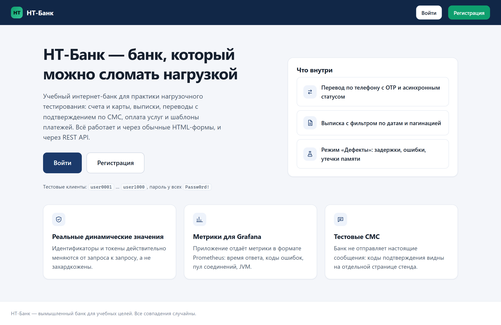<br><sub><b>Стартовая страница</b></sub></td>
    <td width="50%">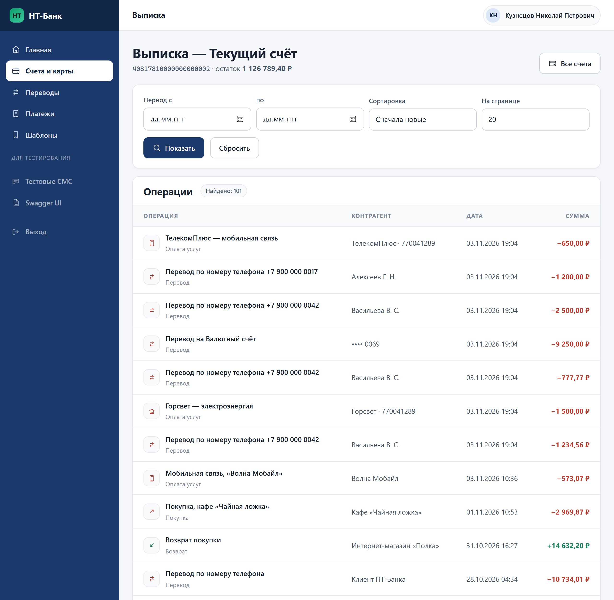<br><sub><b>Выписка</b> — фильтр по датам, сортировка, пагинация</sub></td>
  </tr>
  <tr>
    <td>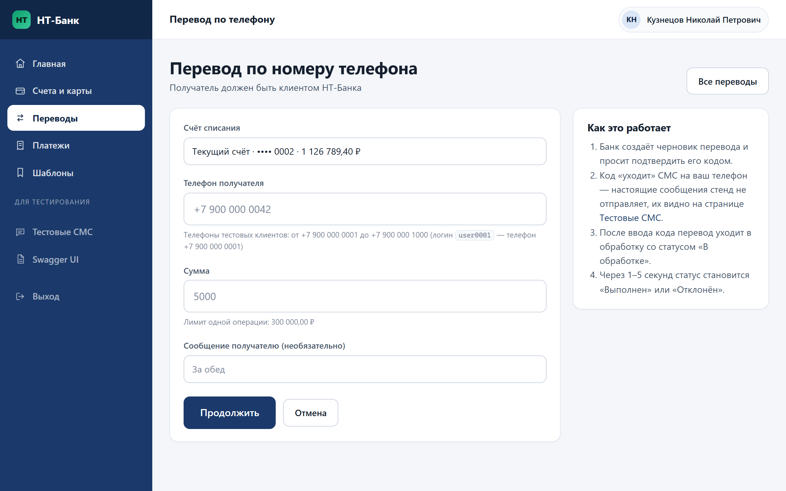<br><sub><b>Перевод по номеру телефона</b></sub></td>
    <td>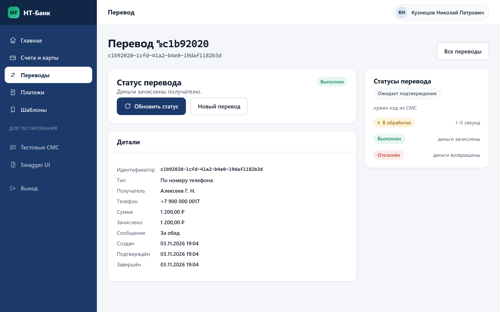<br><sub><b>Перевод выполнен</b> — статус после асинхронной обработки</sub></td>
  </tr>
  <tr>
    <td>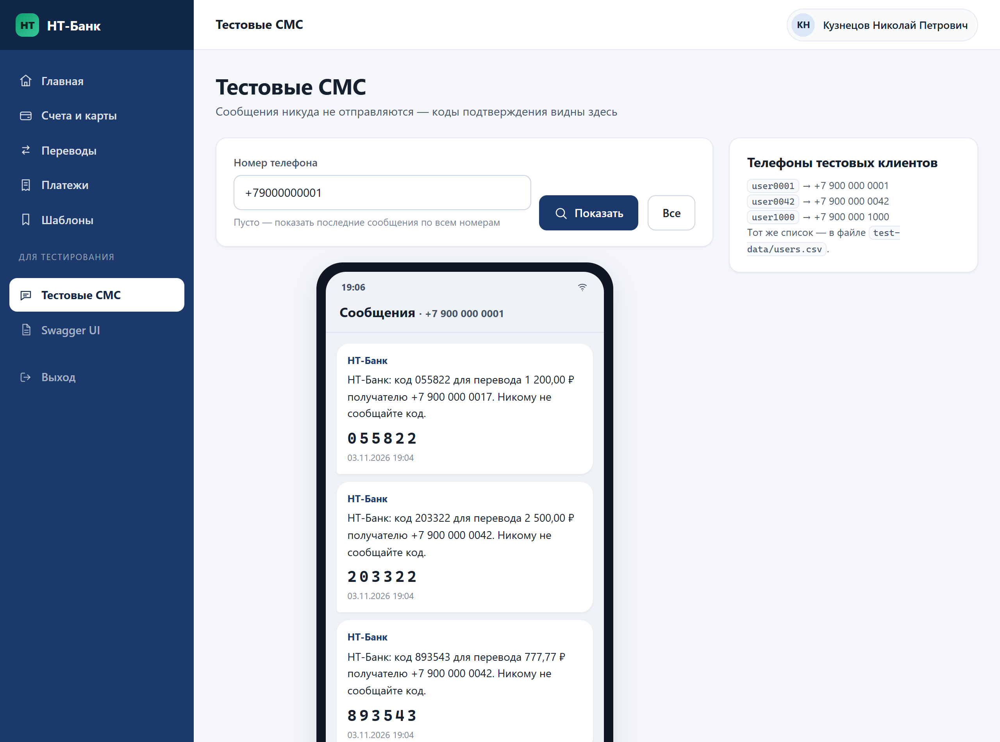<br><sub><b>Тестовые СМС</b> — коды подтверждения для корреляции</sub></td>
    <td>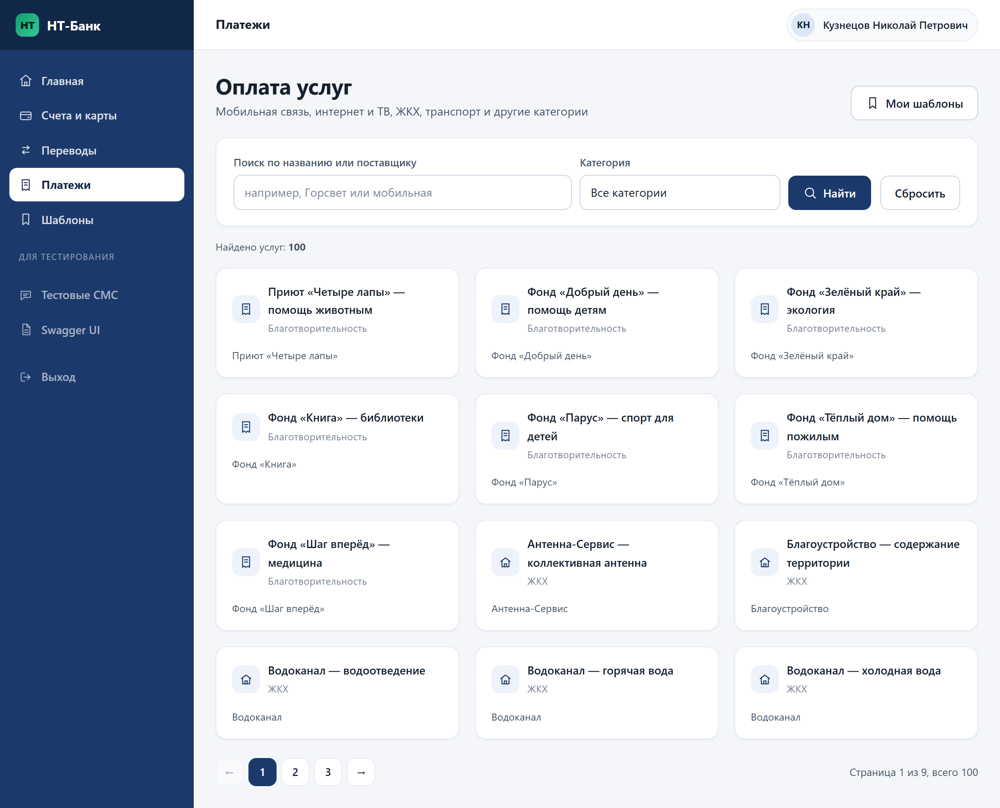<br><sub><b>Оплата услуг</b> — каталог с поиском</sub></td>
  </tr>
  <tr>
    <td>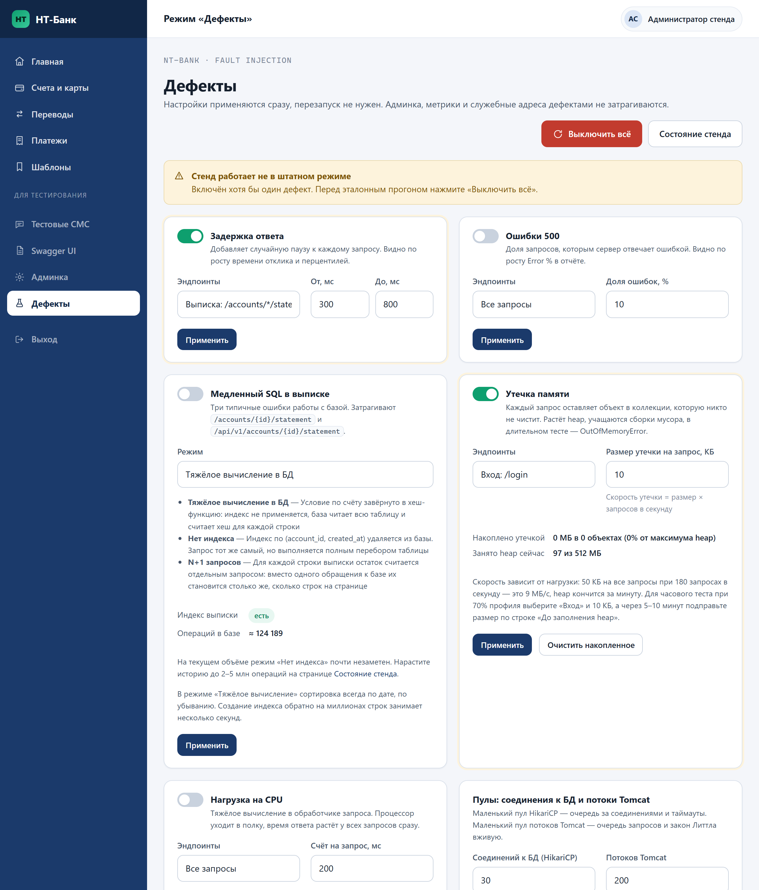<br><sub><b>Режим «Дефекты»</b> — поломки включаются на лету</sub></td>
    <td align="center">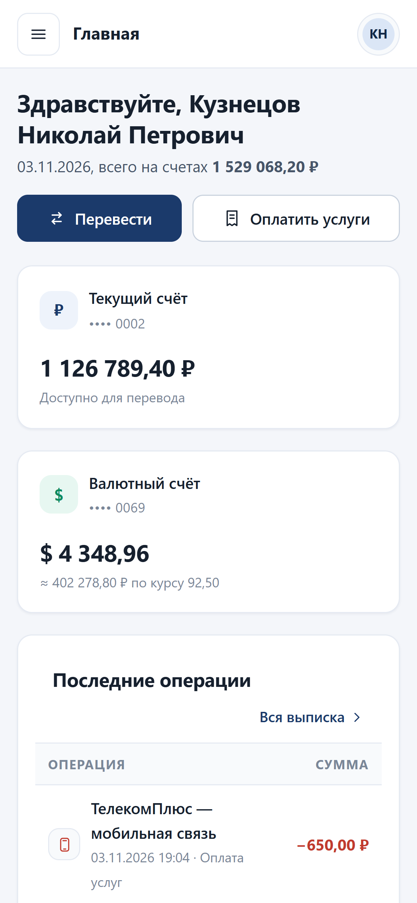<br><sub><b>Мобильная версия</b></sub></td>
  </tr>
</table>

**Grafana во время часового теста надёжности** — 70% профиля нагрузки и включённая утечка памяти.
Видно, как heap растёт ровной линией, как к концу часа учащаются сборки мусора и как после этого
разом «поехало» время ответа:

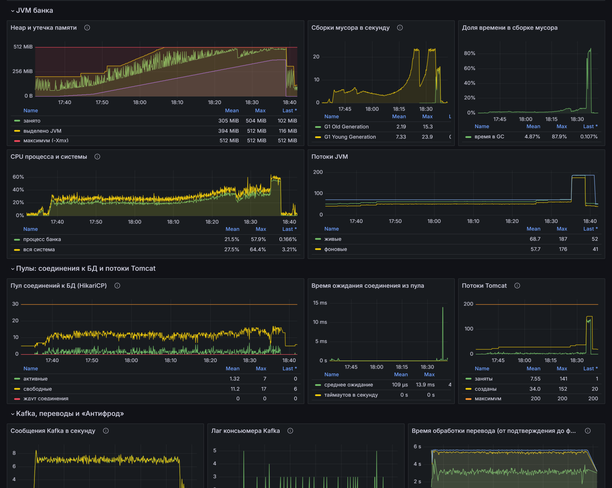

<details>
<summary><b>Ещё скриншоты: обзор дашборда «НТ-Банк», дашборд JMeter, Swagger UI</b></summary>

<br>

**Дашборд «НТ-Банк»: обзор и HTTP** — красная полоса на шкале дефектов показывает, когда была
включена утечка памяти.

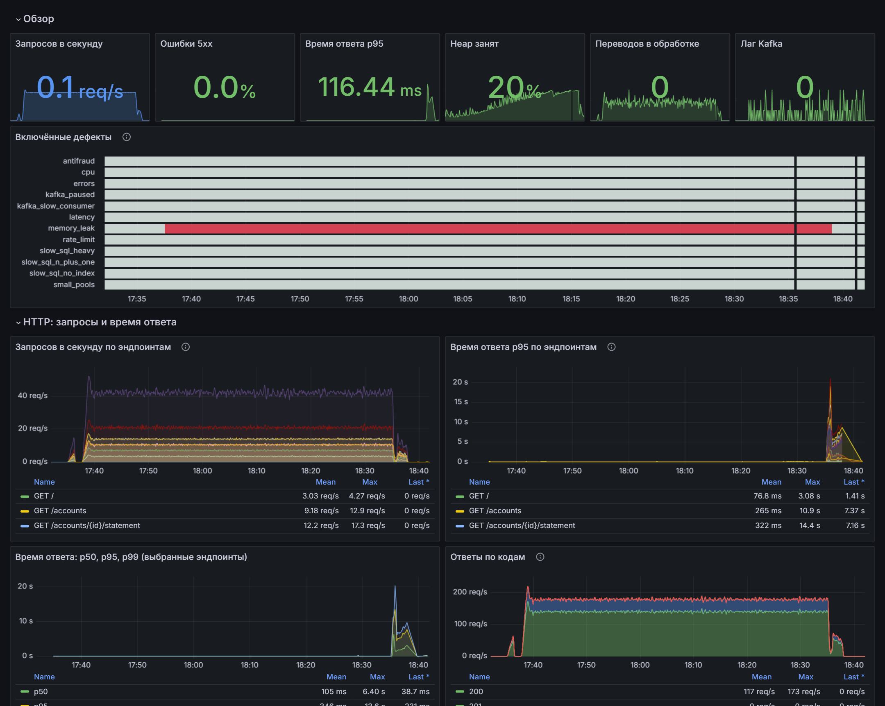

**Дашборд «JMeter + НТ-Банк»** — тот же прогон глазами JMeter через Backend Listener.

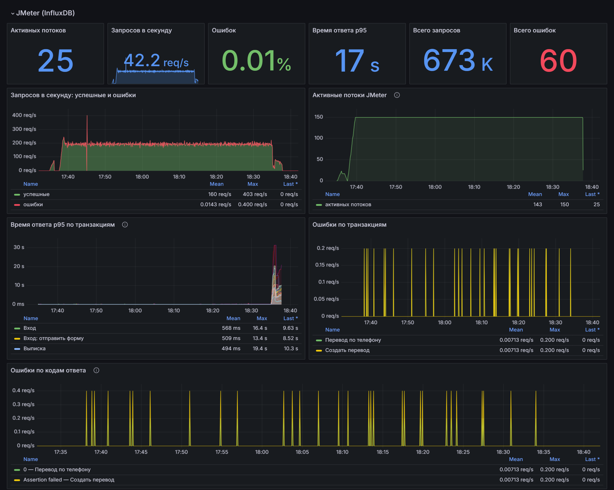

**Swagger UI** — описание REST API, можно отправлять запросы прямо из браузера.

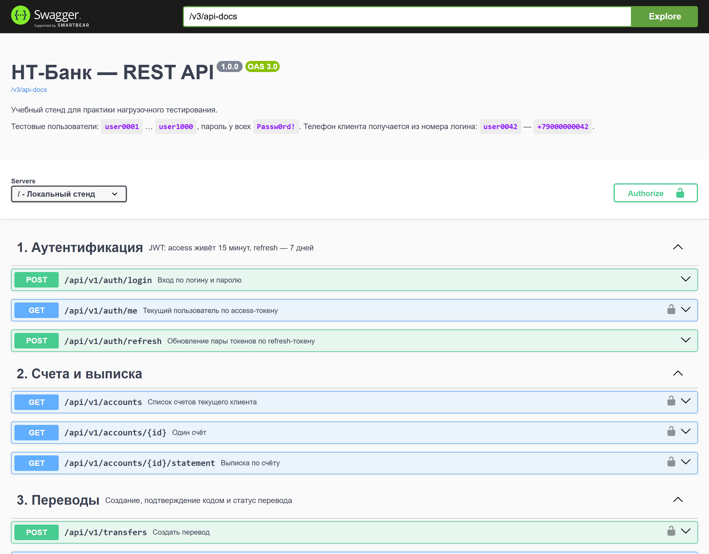

</details>

---

## 🚀 Быстрый старт

### Что нужно

- **Docker Desktop** (на Windows — с WSL2) или Docker Engine с Compose v2. Java и Maven ставить
  не нужно: всё собирается внутри Docker.
- **4–5 ГБ свободной памяти** для Docker (весь стенд в работе занимает около 1,7 ГБ, лимиты — 4 ГБ)
  и около 4 ГБ места на диске под образы.
- **Интернет при первом запуске** — скачиваются образы и зависимости Maven.
- Свободные порты: `8080`, `8081`, `3000`, `9090`, `8086`, `5432`, `29092`.

> 🔒 Все порты открыты только для вашего компьютера (`127.0.0.1`): пароли стенда известны всем,
> кто читал этот README, поэтому из локальной сети — домашней, офисной, в кафе — стенд недоступен.
> Как открыть его для второго компьютера — в [разделе 2](#доступ-с-другого-компьютера).

### Запуск

```bash
git clone https://github.com/MikhailShap/ntbank.git
cd ntbank
docker compose up -d --build
```

Первый запуск занимает 5–10 минут: сборка двух Java-сервисов и загрузка образов. Дальше — секунды.
Стенд готов, когда банк отвечает `UP`:

```bash
curl http://localhost:8080/actuator/health
```

### Куда заходить

| Что | Адрес | Вход |
|---|---|---|
| Интернет-банк | http://localhost:8080 | `user0001` … `user1000` / `Passw0rd!` |
| Тестовые СМС | http://localhost:8080/dev/sms | без входа |
| Режим «Дефекты» | http://localhost:8080/admin/chaos | `admin` / `admin` |
| Swagger UI | http://localhost:8080/swagger-ui | |
| Grafana | http://localhost:3000 | смотреть — без входа, править — `admin` / `admin` |
| Prometheus | http://localhost:9090 | |

Мало памяти? Облегчённый вариант без Kafka и мониторинга — банк и база, около 500 МБ:

```bash
docker compose --profile lite up -d --build
```

Остановить: `docker compose down`. Остановить и удалить все данные: `docker compose down -v`.
Подробности — в [разделе 2](#2-запуск-остановка-сброс-данных), частые проблемы — в
[разделе 10](#10-типичные-проблемы-при-запуске).

---

## 🧩 Архитектура

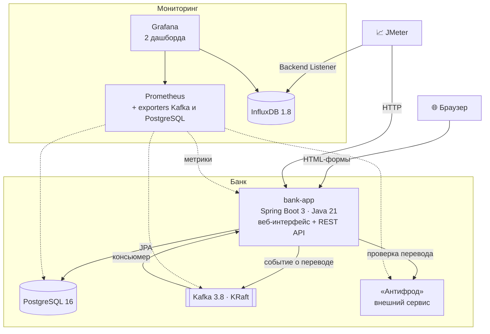

Что происходит при переводе по телефону:

1. Клиент создаёт перевод — банк сохраняет черновик и «отправляет» код в СМС.
2. Клиент вводит код — деньги списываются, перевод получает статус «В обработке».
3. Через 1–5 секунд событие уходит в Kafka; консьюмер забирает его и спрашивает «Антифрод».
4. Перевод становится «Выполнен» (деньги у получателя) или «Отклонён» (деньги вернулись).

---

## 🎯 Первый тест за 15 минут

1. **Поднимите стенд** и войдите в банк под `user0001` / `Passw0rd!` — убедитесь, что всё открывается.
2. **Запишите сценарий.** В JMeter добавьте HTTP(S) Test Script Recorder на порту 8888 и пустите
   браузер через этот прокси. Пройдите: вход → перевод по телефону (код возьмите на странице
   «Тестовые СМС») → оплата услуги → выход. Стенд работает по HTTP — сертификаты не нужны.
3. **Параметризуйте.** CSV Data Set Config с файлом `test-data/users.csv` — 1000 клиентов.
4. **Найдите динамические значения** и вытащите их экстракторами. Их несколько — попробуйте найти
   все сами; список с подсказками спрятан в [разделе 9](#9-подсказки-для-корреляции).
5. **Добавьте проверки** на тексты успеха: «Перевод №… отправлен на обработку», «Платёж №… выполнен».
6. **Подключите Backend Listener** к InfluxDB — параметры в [разделе 8](#8-как-подключить-jmeter).
7. **Запустите из консоли:** `jmeter -n -t plan.jmx -l result.jtl` — и откройте в Grafana
   дашборды «НТ-Банк» и «JMeter + НТ-Банк».
8. **Сломайте что-нибудь:** включите дефект на http://localhost:8080/admin/chaos и найдите его на
   графиках. Готовые задания — в [разделе 7](#7-профиль-нагрузки-для-практики).

---

## 📚 Подробная документация

1. [Что это за стенд и что в нём тренировать](#1-что-это-за-стенд-и-что-в-нём-тренировать)
2. [Запуск, остановка, сброс данных](#2-запуск-остановка-сброс-данных)
3. [Страницы и пользовательские сценарии](#3-страницы-и-пользовательские-сценарии)
4. [REST API](#4-rest-api)
5. [Режим «Дефекты»](#5-режим-дефекты)
6. [Мониторинг: Grafana и Prometheus](#6-мониторинг-grafana-и-prometheus)
7. [Профиль нагрузки для практики](#7-профиль-нагрузки-для-практики)
8. [Как подключить JMeter](#8-как-подключить-jmeter)
9. [Подсказки для корреляции](#9-подсказки-для-корреляции) — под спойлером
10. [Типичные проблемы при запуске](#10-типичные-проблемы-при-запуске)
11. [Структура репозитория](#11-структура-репозитория)

---

## 1. Что это за стенд и что в нём тренировать

| Что тренируем | Где именно |
|---|---|
| Запись сценария рекордером | Весь веб-интерфейс — обычные HTML-формы, HTTP без TLS, без капчи и обязательного JS |
| Корреляцию | CSRF-токен в каждой форме, `transferId`, OTP из «СМС», JWT, id счетов и услуг |
| Параметризацию через CSV | `test-data/users.csv` — 1000 логинов, пароль и телефон |
| Проверки (Response Assertion) | Стабильные тексты успеха: «Перевод №… отправлен на обработку» |
| While Controller | Опрос статуса перевода, пока он не станет `DONE` или `REJECTED` |
| REST-тесты | `/api/v1/**` с JWT, кодами ошибок и заголовком `Idempotency-Key` |
| Поиск узких мест | Режим «Дефекты» + дашборды Grafana |

---

## 2. Запуск, остановка, сброс данных

Нужен только **Docker Desktop (WSL2)**. Java и Maven ставить не нужно — всё собирается внутри Docker.

```bash
docker compose up -d --build
```

Первая сборка занимает 5–10 минут (скачиваются образы и зависимости Maven), последующие — секунды.
Когда контейнер `ntbank-app` станет `healthy`, открывайте:

| Что | Адрес |
|---|---|
| Банк | http://localhost:8080 |
| Swagger UI | http://localhost:8080/swagger-ui |
| Тестовые СМС | http://localhost:8080/dev/sms |
| Админка стенда | http://localhost:8080/admin (`admin` / `admin`) |
| Режим «Дефекты» | http://localhost:8080/admin/chaos (`admin` / `admin`) |
| Метрики банка | http://localhost:8080/actuator/prometheus |
| Grafana | http://localhost:3000 — смотреть можно без входа, править под `admin` / `admin` |
| Prometheus | http://localhost:9090 |
| InfluxDB для JMeter | http://localhost:8086, база `jmeter` |
| Сервис «Антифрод» | http://localhost:8081/actuator/health |
| Kafka (с хоста) | localhost:29092 |

### Сколько нужно памяти

Каждому контейнеру задан лимит памяти, Java-сервисам — явный `-Xmx`. Замер под нагрузкой
(12 клиентов, 2 млн операций в истории):

| Контейнер | Занято | Лимит | Heap Java |
|---|---|---|---|
| bank-app | 560 МБ | 1 ГБ | `-Xmx512m` |
| kafka | 470 МБ | 1 ГБ | `-Xmx512m` |
| postgres | 290 МБ | 512 МБ | — |
| antifraud | 170 МБ | 256 МБ | `-Xmx128m` |
| prometheus | 100 МБ | 512 МБ | — |
| grafana | 85 МБ | 256 МБ | — |
| influxdb | 15 МБ, растёт во время теста JMeter | 384 МБ | — |
| kafka-exporter, postgres-exporter | по 10 МБ | по 64 МБ | — |
| **Итого** | **около 1,7 ГБ** | **4 ГБ** | |

Docker Desktop по умолчанию отдаёт WSL2 половину оперативной памяти — этого хватает.

### Доступ с другого компьютера

По умолчанию все порты слушают только `127.0.0.1` — стенд виден лишь с того компьютера, где он
запущен. Если нужно, например, подавать нагрузку JMeter со второго ноутбука, откройте в
`docker-compose.yml` нужную строку `ports` и уберите из неё `127.0.0.1:`:

```yaml
ports:
  - "8080:8080"            # было "127.0.0.1:8080:8080"
```

Затем `docker compose up -d`. Делайте это только в доверенной сети: логины и пароли стенда
(`admin` / `admin`, `Passw0rd!`, пароль базы `ntbank`) опубликованы в этом README, а пользователь
базы — её администратор. Порт PostgreSQL `5432` без необходимости не открывайте вовсе.

### Облегчённый запуск

Если не хватает памяти, поднимается профиль без Kafka, «Антифрода» и мониторинга — банк и база:

```bash
docker compose --profile lite up -d --build
```

Переводы в этом режиме обрабатываются внутренней очередью в памяти, а антифрод работает
на локальных правилах. Для сценариев в JMeter разницы нет: статусы, тексты и адреса те же.

Полезные команды (PowerShell или cmd, из корня проекта):

```bash
docker compose ps
```

```bash
docker compose logs -f bank-app
```

```bash
docker compose down
```

Полная очистка вместе с базой:

```bash
docker compose down -v
```

### Сброс тестовых данных

Кнопка «Сбросить данные» на странице http://localhost:8080/admin либо запрос:

```bash
curl -X POST http://localhost:8080/api/dev/reset
```

Сброс пересоздаёт пользователей, счета, карты и историю операций, чистит переводы, платежи,
шаблоны и СМС. Занимает несколько секунд. Каталог услуг и курсы валют не меняются.

Сброс можно запускать и во время теста: стенд дожидается текущих запросов, придерживает новые
на эти 3–4 секунды и потом отвечает на них как обычно — на графиках будет короткий провал RPS
и всплеск времени ответа. Переводы, которые тест создал до сброса, после него не найдутся (404).

### Тестовые пользователи

| Логин | Пароль | Телефон |
|---|---|---|
| `user0001` … `user1000` | `Passw0rd!` | `+79000000001` … `+79000001000` |
| `admin` | `admin` | `+79000000000` |

Телефон клиента получается из номера логина: `user0042` → `+79000000042`.
Тот же список лежит в `test-data/users.csv` (UTF-8 без BOM, разделитель — запятая,
заголовок `login,password,phone`) — файл готов для CSV Data Set Config.

### Проверить, что стенд работает

Необязательно, но полезно после первого запуска или после правок в коде. Нужен Python 3,
сторонние библиотеки не требуются. Скрипты сами создают переводы и платежи, поэтому после
них можно сделать сброс данных.

```bash
python tools/smoke_test.py         # все сценарии в вебе и REST, ~30 проверок
python tools/audit_check.py        # требования целиком: коды, форматы ошибок, тестовые данные, ~50 проверок
python tools/edge_check.py         # граничные случаи: суммы, длины полей, неверный JSON, 404/405/415
python tools/race_check.py         # 8 одновременных подтверждений одного перевода — списание одно
python tools/idempotency_check.py  # повторы и одновременные запросы с одним Idempotency-Key
python tools/outage_check.py       # останавливает Kafka, «Антифрод», PostgreSQL и проверяет, что банк это переживает
python tools/ledger_check.py       # минута параллельной нагрузки, потом сверка: деньги сходятся до копейки
python tools/chaos_web_check.py    # каждая форма страницы «Дефекты» отправляется как из браузера
```

Каждый скрипт печатает `ОК`/`СБОЙ` по пунктам и итог. Проверки режима «Дефекты» и
мониторинга — в разделах 5 и 6.

---

## 3. Страницы и пользовательские сценарии

### Карта страниц

| Страница | URL |
|---|---|
| Лендинг | `/` |
| Вход | `/login` |
| Регистрация | `/register` |
| Главная | `/dashboard` |
| Счета и карты | `/accounts` |
| Выписка | `/accounts/{accountId}/statement` |
| Переводы (история) | `/transfers` |
| Перевод между своими | `/transfers/own` |
| Перевод по телефону | `/transfers/phone` |
| Карточка перевода | `/transfers/{transferId}` |
| Оплата услуг | `/payments` |
| Форма оплаты | `/payments/{serviceId}` |
| Шаблоны | `/templates` |
| Тестовые СМС | `/dev/sms?phone=...` |
| Админка | `/admin` |
| Выход | `/logout` (обычная ссылка, метод GET) |

Страница ошибки отдаётся с настоящим HTTP-кодом: чужой или несуществующий перевод — `404`,
неверный параметр в адресе — `400`. Ошибки в формах (неверный код, не хватает денег)
показываются рядом с полем после редиректа обратно на форму — ответ при этом `200`, поэтому
в JMeter такие случаи ловятся проверкой текста на странице, а не кода ответа.

### Сценарий «Перевод по номеру телефона» — главный для стенда

1. Войдите под любым клиентом из `test-data/users.csv`.
2. «Переводы» → «Другому клиенту по телефону».
3. Выберите счёт списания, укажите телефон получателя и сумму, нажмите «Продолжить».
4. Банк создаёт перевод и просит код подтверждения. Настоящие СМС стенд не отправляет —
   код видно на странице «Тестовые СМС» (`/dev/sms`), она открыта без входа в систему.
5. Введите код. На странице появится «Перевод №… отправлен на обработку» и статус «В обработке».
   Код действует 10 минут; на ввод три попытки — после третьей неверной перевод отклоняется.
6. Нажмите «Обновить статус»: через 1–5 секунд он станет «Выполнен» или «Отклонён».

Деньги списываются в момент подтверждения, а зачисляются получателю (или возвращаются
отправителю) при завершении обработки. Часть переводов намеренно отклоняется антифрод-правилами,
а суммы от 150 000 ₽ отклоняются всегда — так в отчёте JMeter будут оба финальных статуса.

### Остальные сценарии

- **Вход и просмотр главной:** `/login` → форма входа → `/dashboard` → `/accounts`.
- **Выписка:** `/accounts/{id}/statement?from=2026-01-01&to=2026-12-31&sort=date_desc&page=0&size=20`.
  Нумерация страниц с нуля, сортировки: `date_desc`, `date_asc`, `amount_desc`, `amount_asc`.
- **Перевод между своими счетами:** `/transfers/own` — выполняется сразу, с конвертацией по курсу.
- **Оплата услуг:** `/payments?query=Горсвет` → карточка услуги → форма оплаты.
- **Шаблоны:** галочка «Сохранить как шаблон» при оплате → `/templates` → «Повторить платёж».
- **Выход:** `/logout` (обычная ссылка, метод GET).

### Что происходит после подтверждения перевода

```
  браузер / JMeter
        │  POST /transfers/{id}/confirm
        ▼
   ┌──────────┐  событие   ┌───────────┐  забирает   ┌──────────┐
   │ bank-app │ ─────────► │   Kafka   │ ──────────► │ bank-app │
   │ (списал) │  1–5 сек   │ 3 раздела │  консьюмер  │(завершил)│
   └──────────┘            └───────────┘             └────┬─────┘
                                                          │ HTTP
                                                          ▼
                                                   ┌─────────────┐
                                                   │  Антифрод   │
                                                   │  :8081      │
                                                   └─────────────┘
```

1. Деньги списываются сразу при подтверждении, перевод получает статус `PROCESSING`.
2. Через 1–5 секунд банк кладёт событие в топик Kafka `nt-bank.transfers`.
3. Консьюмер (группа `nt-bank-processor`, 3 потока) забирает событие и спрашивает «Антифрод».
4. По ответу перевод становится `DONE` (деньги зачислены получателю)
   или `REJECTED` (деньги возвращены отправителю).

Что это даёт для тестирования: если консьюмер остановить или замедлить, растёт лаг и переводы
зависают в `PROCESSING`; если затормозить «Антифрод», удлиняется время обработки; если он
начнёт отвечать ошибками, переводы станут отклоняться. Включайте эти поломки на странице
«Дефекты» (раздел 5) — тогда их состояние видно там же и на дашборде. Напрямую в заглушке
тоже можно, но страница «Дефекты» об этом не узнает, а при перезапуске банка такие настройки сбросятся:

```bash
curl -X POST http://localhost:8081/api/antifraud/chaos -H "Content-Type: application/json" -d "{\"enabled\":true,\"delayMinMs\":2000,\"delayMaxMs\":4000,\"errorPercent\":20}"
```

Сбросить: `curl -X POST http://localhost:8081/api/antifraud/chaos/reset`

### Как убедиться, что переводы идут через Kafka

Список топиков:

```bash
docker exec ntbank-kafka /opt/kafka/bin/kafka-topics.sh --bootstrap-server localhost:9092 --list
```

Отставание консьюмера (колонка LAG): под нагрузкой оно показывает, успевает ли банк
разбирать очередь, а при остановленном консьюмере растёт:

```bash
docker exec ntbank-kafka /opt/kafka/bin/kafka-consumer-groups.sh --bootstrap-server localhost:9092 --describe --group nt-bank-processor
```

Пропускная способность обработки — около 20 переводов в секунду: консьюмер работает в 3 потока,
а «Антифрод» отвечает примерно за 120 мс. Это вдвое больше, чем 10 переводов в секунду на 100%
профиля (раздел 7); если в тесте на максимум лаг начал расти, узкое место нашлось именно здесь.

После перезапуска банка все переводы «В обработке» отправляются в Kafka ещё раз — на случай, если
событие не успело уйти до остановки. Дубли безопасны: обработчик пропускает уже завершённые переводы.
Но если банк перезапустили под большой очередью, лаг сразу после старта может вырасти примерно вдвое.

Сколько проверок обработал «Антифрод»:

```bash
curl -s http://localhost:8081/actuator/prometheus | findstr antifraud_checks_total
```

Текущий режим работы банка виден на странице http://localhost:8080/admin —
поля «Обработка переводов» (`kafka` или `memory`) и «Антифрод» (`http` или `local`).

---

## 4. REST API

Базовый путь `/api/v1`, полное описание — в Swagger UI: http://localhost:8080/swagger-ui

```bash
curl -s -X POST http://localhost:8080/api/v1/auth/login -H "Content-Type: application/json" -d "{\"login\":\"user0001\",\"password\":\"Passw0rd!\"}"
```

| Метод | Путь | Назначение |
|---|---|---|
| POST | `/api/v1/auth/login` | Вход, в ответе `accessToken` (15 минут) и `refreshToken` (7 дней) |
| POST | `/api/v1/auth/refresh` | Обновление пары токенов |
| GET | `/api/v1/auth/me` | Текущий клиент |
| GET | `/api/v1/accounts` | Список счетов |
| GET | `/api/v1/accounts/{id}/statement` | Выписка: `from`, `to`, `sort`, `page`, `size` |
| POST | `/api/v1/transfers` | Создать перевод, в ответе `transferId` |
| POST | `/api/v1/transfers/{id}/confirm` | Подтвердить кодом из СМС |
| GET | `/api/v1/transfers/{id}` | Статус перевода, поле `finalStatus` |
| GET | `/api/v1/services` | Каталог услуг, поиск через `query` |
| POST | `/api/v1/payments` | Оплата услуги |
| GET | `/api/v1/templates` | Шаблоны платежей |
| POST | `/api/v1/templates/{id}/pay` | Повтор платежа по шаблону (тоже понимает `Idempotency-Key`) |
| GET | `/api/dev/sms/last?phone=` | Последняя СМС на номер (без авторизации) |
| POST | `/api/dev/reset` | Сброс тестовых данных (без авторизации) |

Все запросы кроме `/api/v1/auth/**` и `/api/dev/**` требуют заголовок
`Authorization: Bearer <accessToken>`.

### Idempotency-Key

`POST /api/v1/transfers`, `POST /api/v1/payments` и `POST /api/v1/templates/{id}/pay` принимают
заголовок `Idempotency-Key`. Повтор с тем же ключом не создаёт вторую операцию: возвращается
сохранённый ответ (тот же `transferId` / `paymentId`) с заголовком `Idempotency-Replayed: true`.

- Ключ действует в пределах одного клиента и одного вида операции: у разных клиентов
  одинаковые ключи друг другу не мешают.
- Если несколько запросов с одним ключом пришли одновременно, операцию выполняет первый,
  остальные ждут его результата (до 10 секунд) и получают тот же ответ. Не дождались —
  `409` с кодом `IDEMPOTENCY_IN_PROGRESS`, запрос можно повторить.
- Ответ с ошибкой (400, 404, 409) не запоминается: повтор с тем же ключом выполнится заново.
- Ключ — не длиннее 100 символов; удобнее всего `${__UUID()}`.

### Ограничения полей

Одни и те же для веб-форм и REST; нарушение — `400` с понятным текстом, а не `500`.

| Поле | Правило |
|---|---|
| Сумма перевода и платежа | больше нуля, не больше двух знаков после запятой. В веб-форме можно писать и `100,50`, и `100.50` |
| Перевод между своими в другой валюте | сумма после пересчёта должна быть хотя бы 1 цент / 1 копейка (`AMOUNT_TOO_SMALL`) |
| Комментарий к переводу | до 160 символов |
| Лицевой счёт / номер телефона в платеже | до 40 символов |
| Название шаблона | до 80 символов |
| Код подтверждения | действует 10 минут, три попытки: после третьей неверной перевод сразу отклоняется (`409 OTP_ATTEMPTS_EXCEEDED`) |

### Коды ошибок

| Код | Когда |
|---|---|
| 400 | Ошибка валидации, неверный OTP, неверный формат телефона, сумма вне лимитов |
| 401 | Нет или истёк токен, неверный логин/пароль |
| 403 | Недостаточно прав (например, админский эндпоинт под обычным клиентом) |
| 404 | Счёт, перевод, услуга или шаблон не найдены, неизвестный адрес API |
| 405 | Метод не поддерживается для этого адреса (например, `DELETE /api/v1/accounts`) |
| 409 | Недостаточно средств, перевод уже подтверждён, истёк срок OTP, исчерпаны попытки ввода кода, повтор ключа идемпотентности, пока первый запрос ещё выполняется |
| 415 | Тело запроса отправлено не как JSON — нет заголовка `Content-Type: application/json` |
| 429 | Превышен лимит запросов — включён дефект «Ограничение частоты», в ответе заголовок `Retry-After: 1` |
| 500 | Внутренняя ошибка (в том числе намеренная из режима «Дефекты») |

Тело ошибки одинаково для всех случаев:

```json
{"timestamp":"2026-10-21T10:15:30","status":409,"error":"Conflict",
 "code":"INSUFFICIENT_FUNDS","message":"Недостаточно средств на счёте","path":"/api/v1/transfers"}
```

Тот же формат у ответов, которые формируются ещё до контроллеров: `401` (`UNAUTHORIZED` —
нет токена, `INVALID_TOKEN` — токен испорчен или истёк, `WRONG_TOKEN_TYPE` — передан refresh
вместо access), `403` (`FORBIDDEN`), `429` (`RATE_LIMITED`) и `500` из режима «Дефекты»
(`CHAOS_ERROR`). Поэтому проверку в JMeter удобно ставить на поле `code`. У ошибок валидации
(400, `VALIDATION_ERROR`) есть ещё поле `fieldErrors` — сообщение для каждого поля.
Неизвестный адрес под `/api/` — `404 NOT_FOUND`, не тот метод — `405 METHOD_NOT_ALLOWED`,
поле JSON не того типа (`"amount": "сто"`) — `400` с именем поля в `message`.
Админский REST без пароля отвечает `401` в том же формате и с заголовком
`WWW-Authenticate: Basic`, чтобы браузер показал окно входа.

---

## 5. Режим «Дефекты»

Страница **http://localhost:8080/admin/chaos** (пользователь `admin`, пароль `admin`).
Каждая карточка — отдельный дефект со своим переключателем и кнопкой «Применить».
Настройки действуют сразу, перезапуск не нужен. Наверху — кнопка **«Выключить всё»**
и плашка, которая честно говорит, что стенд работает не в штатном режиме.

Админка, `/actuator/**`, `/api/dev/**` и статика дефектами не затрагиваются —
иначе включённый дефект не дал бы себя выключить.

| Дефект | Что делает | Что видно под нагрузкой |
|---|---|---|
| Задержка ответа | случайная пауза от N до M мс на выбранных эндпоинтах | рост среднего времени отклика и перцентилей, при этом RPS упирается в потолок |
| Ошибки 500 | заданная доля запросов получает ошибку | рост Error % в отчёте, срабатывание Response Assertion |
| Медленный SQL | три режима на выбор: «Нет индекса», «N+1 запросов», «Тяжёлое вычисление в БД» — подробно [ниже](#медленный-sql-три-режима) | падение пропускной способности выписки; насколько сильное — зависит от режима и объёма истории |
| Утечка памяти | каждый запрос оставляет объект заданного размера (по умолчанию 50 КБ) в коллекции, которую никто не чистит | рост heap «пилой» вверх, учащение сборок мусора, в итоге OutOfMemoryError — как подобрать скорость, [ниже](#утечка-памяти-как-подобрать-скорость) |
| Нагрузка на CPU | тяжёлое вычисление в обработчике | процессор в полке, время ответа растёт у всех запросов сразу |
| Пул соединений к БД | размер пула HikariCP меняется на лету (например, 2) | очередь за соединениями, таймауты, провал пропускной способности |
| Пул потоков Tomcat | `max-threads` меняется на лету | очередь запросов перед приложением, закон Литтла вживую |
| Тормозит «Антифрод» | задержка и ошибки во внешнем сервисе | переводы дольше висят в `PROCESSING`, при ошибках отклоняются с причиной «Сервис антифрода недоступен» |
| Kafka: пауза и медленный консьюмер | консьюмер ставится на паузу или замедляется | растёт лаг группы `nt-bank-processor`, статусы переводов не обновляются |
| Rate limit | лимит запросов в секунду на пользователя | ответы 429 с заголовком `Retry-After` |

### Через REST

Те же настройки доступны по HTTP Basic (`admin` / `admin`). В Swagger UI для этого раздела
нажмите «Authorize» и заполните блок `admin-basic`, токен клиента здесь не подойдёт:

```bash
curl -s -u admin:admin http://localhost:8080/api/admin/chaos
```

Поля необязательные — передавайте только то, что меняете:

```bash
curl -s -u admin:admin -X POST http://localhost:8080/api/admin/chaos -H "Content-Type: application/json" -d "{\"latencyEnabled\":true,\"latencyTarget\":\"STATEMENT\",\"latencyMinMs\":700,\"latencyMaxMs\":900}"
```

Выключить всё:

```bash
curl -s -u admin:admin -X POST http://localhost:8080/api/admin/chaos/reset
```

Значения `latencyTarget`, `errorsTarget`, `leakTarget`, `cpuTarget`: `ALL`, `WEB`, `API`,
`LOGIN`, `DASHBOARD`, `ACCOUNTS`, `STATEMENT`, `TRANSFERS`, `PAYMENTS`.

### Медленный SQL: три режима

Все три режима затрагивают только выписку (`/accounts/{id}/statement` и
`/api/v1/accounts/{id}/statement`). Режим выбирается в карточке «Медленный SQL в выписке»
или полем `slowSqlMode` в REST: `NO_INDEX`, `N_PLUS_ONE`, `HEAVY_COMPUTE`.

**Нет индекса.** При включении из базы удаляется индекс `idx_operation_account_date`
по `(account_id, created_at)`, при выключении он создаётся обратно. Код и запрос не меняются —
меняется только план выполнения: вместо чтения нескольких десятков строк по индексу PostgreSQL
перебирает всю таблицу операций. Это самая жизненная из трёх поломок: индекс «забыли» в миграции
или удалили, и на тестовом стенде с маленькой базой этого никто не заметил.

**N+1 запросов.** Выписка загружается одним запросом, а затем для каждой строки отдельным
запросом считается остаток на момент операции. Страница из 20 строк — 21 обращение к базе
вместо одного, из 100 строк — 101. Каждое обращение по отдельности быстрое и в логах медленных
запросов не появится; тормозит их количество.

**Тяжёлое вычисление в БД.** Условие по счёту завёрнуто в хеш-функцию: индекс не применяется,
и база считает хеш для каждой строки таблицы. Нагружает процессор PostgreSQL, на 2 млн операций
фактически кладёт выписку — используйте как демонстрацию, а не для длинных тестов.
В этом режиме сортировка выписки всегда по дате, по убыванию.

#### Как это выглядит в цифрах

Замер `tools/sql_modes_bench.py`: 16 клиентов параллельно запрашивают выписку по своим счетам
в течение 15 секунд, страница 20 строк. Стенд на Docker Desktop, ноутбук.

На стандартном объёме (100–200 тысяч операций):

| Режим | Одиночный запрос | RPS | p50 | p95 | Индексных сканов на запрос | Строк полным перебором на запрос |
|---|---|---|---|---|---|---|
| Штатный режим | 5 мс | 938 | 16 мс | 23 мс | 2 | 0 |
| Нет индекса | 31 мс | 238 | 64 мс | 102 мс | 0 | 306 776 |
| N+1 запросов | 9 мс (100 строк — 29 мс) | 696 | 22 мс | 34 мс | 21 | 0 |
| Тяжёлое вычисление в БД | 644 мс | 7 | 2 081 мс | 3 402 мс | 1 | 136 663 |

На 2 млн операций:

| Режим | Одиночный запрос | RPS | p50 | p95 | Индексных сканов на запрос | Строк полным перебором на запрос |
|---|---|---|---|---|---|---|
| Штатный режим | 7 мс | 853 | 18 мс | 26 мс | 2 | 0 |
| Нет индекса | 108 мс | 24 | 701 мс | 1 028 мс | 0 | 3 950 709 |
| N+1 запросов | 26 мс (100 строк — 90 мс) | 284 | 53 мс | 85 мс | 21 | 0 |
| Тяжёлое вычисление в БД | 2 472 мс | 0,8 | 21 900 мс | 23 693 мс | 0 | 4 000 106 |

Что из этого следует:

- Со штатным индексом стоимость выписки почти не зависит от объёма: 938 и 853 RPS.
- «Нет индекса» на маленькой базе почти не виден по одиночному запросу (31 мс), но под нагрузкой
  пропускная способность падает вчетверо. На 2 млн операций — в 35 раз. Поэтому для этого
  режима нужен реалистичный объём истории (см. ниже).
- «N+1» тоже растёт с объёмом: каждый лишний запрос считает остаток по всей истории счёта.
  Главный его признак — не время, а число обращений к базе на один HTTP-запрос.

#### Как это видно на графиках

| Режим | Время ответа и RPS | Пул соединений HikariCP | PostgreSQL |
|---|---|---|---|
| Нет индекса | p95 выписки растёт, RPS упирается в потолок | растёт число активных соединений и ожидающих в очереди | резкий рост «строк прочитано полным перебором», больше активных запросов в базе |
| N+1 | умеренный рост p95, падение RPS | активные соединения заняты дольше; при маленьком пуле — очередь | в разы растёт число индексных сканов `operation` в секунду при том же RPS выписки |
| Тяжёлое вычисление | время ответа уходит в секунды, RPS почти ноль | все соединения заняты, очередь, таймауты | полные переборы таблицы, активные запросы висят секундами |

Все эти графики есть на дашборде «НТ-Банк» в блоках «Пулы» и «PostgreSQL». Те же счётчики
можно посмотреть и напрямую в базе:

```bash
docker exec ntbank-postgres psql -U ntbank -d ntbank -c "select idx_scan, seq_scan, seq_tup_read from pg_stat_user_tables where relname = 'operation'"
```

#### Реалистичный объём истории

По умолчанию в базе ~125 тысяч операций. Для режима «Нет индекса» нарастите историю до 2–5 млн
(максимум — 10 млн; число больше отклоняется с ошибкой 400):

- кнопкой «Нарастить» на странице http://localhost:8080/admin;
- по REST: `curl -u admin:admin -X POST "http://localhost:8080/api/admin/history?total=2000000"`;
- при запуске: раскомментируйте `SEED_OPERATIONS_TOTAL=2000000` в файле `.env` и пересоздайте
  контейнер банка (`docker compose up -d`) — история дорастёт при старте.

2 млн операций создаются меньше чем за минуту, 5 млн — за две-три минуты; на диске это
около 400 МБ и 1 ГБ соответственно. Пока история наращивается, сброс данных отвечает `409` —
дождитесь окончания. Сброс (`/api/dev/reset`) возвращает историю к ~125 тысячам, если в `.env`
не задан `SEED_OPERATIONS_TOTAL`.

### Утечка памяти: как подобрать скорость

На карточке показаны размер утечки на запрос (по умолчанию 50 КБ), сколько уже накоплено,
занятый heap, фактическая скорость роста и примерное время до заполнения heap.
Время до OutOfMemoryError определяется не настройкой, а нагрузкой:

```
скорость утечки = размер на запрос × запросов в секунду к выбранным эндпоинтам
время до OOM    ≈ свободный heap / скорость утечки
```

У банка `-Xmx512m`. Живых данных после сборки мусора в простое — около 60 МБ. Под нагрузкой к ним
добавляются веб-сессии: вход без выхода живёт 30 минут, и при 70% профиля за первые полчаса
набирается ~13 тысяч сессий и ~70 МБ, дальше плато. Это не утечка, хотя первые полчаса на графике
похоже. Остаётся примерно 330 МБ под утечку.

Учтите: для цели «Вход» считаются только открытия страницы `GET /login` — отправку формы
`POST /login` обрабатывает Spring Security раньше фильтра дефектов. При 70% профиля это ~10 запросов
в секунду, а не 20.

| Сценарий | Эндпоинты | Запросов в секунду | Размер на запрос | Когда heap заполнится |
|---|---|---|---|---|
| Демонстрация OutOfMemoryError | все запросы | ~180 (70% профиля) | 2048 КБ | за секунды |
| Значение по умолчанию | все запросы | ~180 | 50 КБ | меньше минуты |
| Тест надёжности на час | только вход `/login` | ~10 (70% профиля) | 10 КБ | около часа |
| Тест надёжности на 3 часа | только вход `/login` | ~10 | 3 КБ | около трёх часов |

Строка «на час» проверена прогоном JMeter: 70% профиля, 10 входов в секунду, утечка ~6,5 МБ в минуту —
heap заполнился к 55-й минуте.

Значение по умолчанию удобно для коротких экспериментов на одном эндпоинте с невысокой нагрузкой.
Для теста надёжности выберите один эндпоинт и несколько килобайт, а через 5–10 минут после
старта сверьтесь со строкой «До заполнения heap» и при необходимости поправьте размер — новое
значение применяется сразу.

**Как выглядит конец теста.** OutOfMemoryError наступает не сразу. Сначала начинается шторм полных
сборок мусора: в том прогоне на последних пяти минутах их было ~180 в минуту, GC занимал 23% времени,
p95 вырос с 60 мс до 8–17 секунд, CPU — с 20% до 55%, пропускная способность упала со 179 до
151 запроса в секунду. Именно это тест надёжности и должен поймать. Если в этот момент нажать
«Выключить всё», heap освобождается без перезапуска, и время ответа сразу возвращается к норме.

**Что происходит при OutOfMemoryError.** Банк запущен с `-XX:+ExitOnOutOfMemoryError`:
процесс завершается, и Docker поднимает контейнер заново примерно за 10 секунд — так же
ведёт себя Kubernetes при OOMKill. На графиках это выглядит так: heap растёт пилой, сборки
мусора учащаются, затем 10–20 секунд нет данных, и heap начинается с нуля. После перезапуска
все дефекты выключены, веб-сессии потеряны — в JMeter запросы с входом получат редирект
на `/login`, а REST-запросы со старым токеном продолжат работать.

Без этого флага JVM после OutOfMemoryError оставалась бы «зомби»: ошибка убивает потоки,
принимающие соединения, а процесс живёт дальше и не отвечает. Docker такой контейнер
не перезапускает — он перезапускает только завершившийся процесс.

### Проверить, что дефекты действительно срабатывают

```bash
python tools/chaos_check.py
```

Скрипт включает каждый дефект по очереди, измеряет эффект и в конце возвращает стенд
в штатный режим. «Выключить всё» заодно очищает накопленную утечку и создаёт обратно индекс,
если был включён режим «Нет индекса».

Подробный замер режимов медленного SQL под параллельной нагрузкой:

```bash
python tools/sql_modes_bench.py --grow 2000000
```

---

## 6. Мониторинг: Grafana и Prometheus

Prometheus каждые 5 секунд опрашивает банк, «Антифрод», Kafka (через kafka-exporter)
и PostgreSQL (через postgres-exporter). Grafana поднимается с уже настроенными источниками
данных и двумя дашбордами в папке «НТ-Банк» — руками ничего настраивать не нужно.
Главная страница Grafana сразу открывает дашборд «НТ-Банк».

### Дашборд «НТ-Банк»

http://localhost:3000/d/ntbank-main

| Блок | Что на нём | Вопрос, на который отвечает |
|---|---|---|
| Обзор | RPS, доля ошибок 5xx, p95, занятость heap, переводы в обработке, лаг Kafka; **шкала включённых дефектов** | всё ли в порядке прямо сейчас и что было включено, когда графики поехали |
| HTTP | RPS и p95 по каждому эндпоинту, p50/p95/p99, ответы по кодам, доля ошибок 4xx/5xx | какой эндпоинт тормозит или сыплет ошибками |
| JVM банка | heap и накопленная утечка, сборки мусора, доля времени в GC, CPU процесса, потоки | хватает ли памяти и процессора |
| Пулы | соединения HikariCP (активные, свободные, ждут, максимум), время ожидания соединения, потоки Tomcat | где очередь — перед базой или перед приложением |
| Kafka, переводы и «Антифрод» | сообщения в секунду (записано и разобрано), лаг, время обработки перевода, переводы по статусам, проверки антифрода | успевает ли асинхронная обработка |
| PostgreSQL | чтения по индексу и полные переборы таблицы операций, строки, прочитанные перебором, транзакции, активные запросы, объём данных | что именно делает база |

Наверху есть фильтр «Эндпоинт» — он сужает графики блока HTTP. Админка, `/actuator/**` и сброс
данных в HTTP-графики не попадают: сброс идёт несколько секунд, наращивание истории — минуту, и такой
вызов в простое показывал бы p95 в десятки секунд, хотя клиентская нагрузка тут ни при чём.

### Дашборд «JMeter + НТ-Банк»

http://localhost:3000/d/ntbank-jmeter

Верхняя половина — метрики теста из InfluxDB: активные потоки, RPS (успешные и ошибки),
время ответа по транзакциям, ошибки по транзакциям и по кодам ответа. Нижняя половина —
метрики приложения из Prometheus за то же время: шкала дефектов, RPS и p95 по эндпоинтам банка,
heap, пул соединений, CPU, лаг Kafka, время обработки перевода. Старт и окончание теста
отмечаются на графиках вертикальными линиями.

Так на одном экране видно и то, что «чувствует» JMeter, и то, что в этот момент происходит
внутри банка. Как подключить JMeter — в [разделе 8](#8-как-подключить-jmeter).

### Как дефекты выглядят на дашборде

Проверено скриптом `tools/dashboard_defects_check.py`: 12 клиентов дают фоновую нагрузку
через REST (для дефектов пулов — ещё 24 клиента без пауз), дефекты включаются по очереди
на 40 секунд, и сравнивается метрика той панели, где дефект должен быть виден, — тем же
запросом, что и в Grafana. Пока дефект включён, на шкале «Включённые дефекты» горит
красная полоса.

| Дефект и настройка проверки | Панель дашборда | До | Во время |
|---|---|---|---|
| Задержка 300–600 мс, все запросы | Время ответа p95 | 0,01 с | 0,61 с |
| Ошибки 500, 20% REST-запросов | Ошибки 5xx | 0% | 17% |
| Медленный SQL «Нет индекса», 2 млн операций | Строк прочитано полным перебором в секунду | 0 | 77,7 млн |
| Медленный SQL «N+1» | Обращения к таблице операций: чтений по индексу | 97 в секунду | 946 в секунду |
| Медленный SQL «Тяжёлое вычисление» | Время ответа p95 по эндпоинтам (выписка) | 0,01 с | 22 с |
| Утечка памяти, 20 КБ на запрос к счетам | Heap и утечка памяти | 0 МБ | 72 МБ за 40 секунд |
| Нагрузка на CPU, 150 мс на REST-запрос | CPU процесса и системы | 4% | 68% |
| Пул соединений к БД = 2 | Время ожидания соединения из пула | 0 мс | 40 мс |
| Пул потоков Tomcat = 2 | Потоки Tomcat (занято от максимума) | 4% | 100% |
| Тормозит «Антифрод»: 3–5 с, 30% ошибок | Время обработки перевода p95 | 5,5 с | 36,7 с |
| Kafka: пауза консьюмера | Лаг консьюмера Kafka | 453 | 769 |
| Ограничение частоты: 3 запроса в секунду | Ответы по кодам (429) | 0 | 135 в секунду |

На что обратить внимание:

- **Пул потоков Tomcat — серверный p95 почти не меняется.** Очередь к потокам стоит перед
  приложением, а `http_server_requests` начинает отсчёт, когда поток уже взял запрос.
  Рост времени ответа видит только клиент: в проверке p95 у клиента вырос с 40 до 59 мс,
  у сервера остался 10 мс. Поэтому смотрите панель «Потоки Tomcat» (занятые упираются
  в максимум) и время ответа на дашборде JMeter — там оно настоящее.
- **Пул соединений к БД — время растёт и у сервера, и у клиента:** ожидание соединения
  происходит внутри обработки запроса. В проверке p95 у клиента вырос с 40 до 173 мс.
- **Дефекты каскадируются.** Лаг Kafka был 453 ещё до паузы консьюмера: это хвост
  предыдущего шага. Пока «Антифрод» отвечал по 3–5 секунд, консьюмер ждал его на каждом
  сообщении, и очередь копилась. Тормозящая внешняя система роняет асинхронную обработку.
- **Утечка при неудачном выборе размера кладёт банк за секунды.** Первая версия проверки
  включала 200 КБ на все запросы, и при ~100 запросах в секунду heap кончился секунд за 25.

### Как проверить, что мониторинг работает

```bash
curl -s http://localhost:9090/api/v1/targets
```

Все цели должны быть в состоянии `up`: bank-app, antifraud, kafka, postgres, prometheus.
Проверить, что каждый запрос дашбордов возвращает данные (запускать во время нагрузки):

```bash
python tools/check_dashboards.py
```

Дашборды собираются скриптом `tools/gen_dashboards.py`. Чтобы поменять дашборд надолго,
правьте скрипт и запускайте его заново — Grafana подхватит файлы в течение 30 секунд.
Правки, сделанные мышкой в Grafana, хранятся в её томе и пропадут после `docker compose down -v`.

---

## 7. Профиль нагрузки для практики

| Операция | Доля | Интенсивность на 100% профиля |
|---|---|---|
| Вход | 15% | 15 оп/с |
| Просмотр главной и счетов | 35% | 35 оп/с |
| Выписка | 20% | 20 оп/с |
| Перевод по телефону (с OTP и ожиданием статуса) | 10% | 10 оп/с |
| Оплата услуг | 15% | 15 оп/с |
| Выход | 5% | 5 оп/с |

Учебные задания:

1. **Поиск максимума ступенями.** Подавайте 25 / 50 / 75 / 100 / 125% профиля по 10 минут на ступень.
   Зафиксируйте ступень, на которой время отклика 90-го перцентиля перестаёт держаться в SLA.
2. **Тест надёжности (1 час).** 70% профиля с включённой утечкой памяти — цель «Вход», 10 КБ на запрос
   (см. раздел 5). Смотрите на рост heap после сборок мусора, их частоту и на то, в какой момент
   поехало время ответа.
3. **Стресс со скачком.** 50% профиля, затем резкий скачок до 150% на 3 минуты и возврат.
   Проверьте, восстанавливается ли время отклика.
4. **Отказ «Антифрода».** Под нагрузкой включите задержку и ошибки во внешнем сервисе на странице «Дефекты»
   и посмотрите, как растёт очередь переводов в статусе `PROCESSING`.

---

## 8. Как подключить JMeter

**Рекордер.** HTTP(S) Test Script Recorder, порт 8888, браузер с прокси на `localhost:8888`.
Стенд работает по HTTP, поэтому сертификаты не нужны. В Requests Filtering исключите статику:
`.*\.(css|js|svg|ico|png|woff2)`.

**CSV Data Set Config.** Файл `test-data/users.csv`, Variable Names `login,password,phone`,
Delimiter `,`, Recycle on EOF `True`, Sharing mode `All threads`, кодировка `UTF-8`,
Ignore first line `True`.

**Cookie Manager** обязателен для веб-сценариев — сессия держится на `JSESSIONID`.

**Backend Listener (InfluxDB)** — чтобы видеть тест на дашборде «JMeter + НТ-Банк».
Добавьте в план Listener → Backend Listener и заполните:

| Параметр | Значение |
|---|---|
| Backend Listener implementation | `org.apache.jmeter.visualizers.backend.influxdb.InfluxdbBackendListenerClient` |
| influxdbMetricsSender | `org.apache.jmeter.visualizers.backend.influxdb.HttpMetricsSender` |
| influxdbUrl | `http://localhost:8086/write?db=jmeter` |
| application | любое имя теста, например `ntbank-max` — по нему выбирается тест на дашборде |
| measurement | `jmeter` |
| summaryOnly | **`false`** — иначе JMeter отправит только сводку, без разбивки по транзакциям |
| samplersRegex | `.*` |
| percentiles | `90;95;99` |
| testTitle | описание теста, попадёт в отметки старта и окончания |

Проверить связку JMeter → InfluxDB → Grafana можно готовым планом. Это не сценарий нагрузки
на банк: только публичные страницы без входа и корреляции и один запрос к REST без токена,
который всегда получает 401 — чтобы на дашборде было видно ошибки.

```bash
jmeter -n -t tools/jmeter/backend-listener-check.jmx -l result.jtl
```

После запуска откройте дашборд «JMeter + НТ-Банк» и выберите тест `ntbank-check`.
Параметры можно переопределить: `-Jthreads=20 -Jduration=120 -Jhost=localhost`.

**Transaction Controller и итоги на дашборде.** Backend Listener отправляет в InfluxDB и сами
транзакции, поэтому «Всего запросов» и «Всего ошибок» на дашборде больше, чем в сводке JMeter
в консоли: упавший запрос внутри транзакции считается дважды — как запрос и как транзакция.
Чтобы считать только запросы, исключите транзакции через `samplersRegex` (например, дайте им
общий префикс и отфильтруйте его) или смотрите панели «по транзакциям».

---

## 9. Подсказки для корреляции

<details>
<summary>Открыть список динамических значений (сначала попробуйте найти их сами)</summary>

| Значение | Откуда взять | Куда подставить |
|---|---|---|
| `_csrf` | Скрытое поле любой HTML-формы: `name="_csrf" value="..."` | Все POST-запросы веб-интерфейса |
| `JSESSIONID` | Cookie после `POST /login` | Автоматически через Cookie Manager |
| `accountId` | `GET /dashboard` или `/accounts` — ссылки `/accounts/{id}/statement`; в REST — `GET /api/v1/accounts` | `fromAccountId`, `accountId` |
| `transferId` | Заголовок `Location` после `POST /transfers/phone` (редирект на `/transfers/{id}`); в REST — поле `transferId` | `POST /transfers/{id}/confirm`, `GET /transfers/{id}` |
| `otp` | `GET /api/dev/sms/last?phone=${phone}` — поле `code`; или страница `/dev/sms` | Поле `otp` при подтверждении |
| `accessToken` | `POST /api/v1/auth/login` — поле `accessToken` | Заголовок `Authorization: Bearer ...` |
| `refreshToken` | Там же, поле `refreshToken` | `POST /api/v1/auth/refresh` |
| `serviceId` | `GET /payments` — ссылки `/payments/{id}`; в REST — `GET /api/v1/services` | Форма оплаты |
| `paymentId` | Текст успеха «Платёж №… выполнен»; в REST — поле `paymentId` | Проверки |
| `templateId` | `GET /templates` — адреса форм `/templates/{id}/pay` | Повтор платежа |

Регулярные выражения, которые пригодятся:

```
_csrf"\s+value="([^"]+)"
/transfers/([0-9a-f-]{36})
"code"\s*:\s*"(\d{6})"
"accessToken"\s*:\s*"([^"]+)"
```

Тексты для Response Assertion:

- `Перевод №` + `отправлен на обработку` — успешное подтверждение перевода;
- `Платёж №` + `выполнен` — успешная оплата;
- `Здравствуйте,` — успешный вход;
- `Недостаточно средств на счёте` — ожидаемая ошибка 409.

### Порядок шагов, если нужен готовый каркас

**Веб-сценарий перевода.** `GET /login` (взять `_csrf`) → `POST /login` с полями `login`,
`password`, `_csrf` → `GET /transfers/phone` (новый `_csrf`) → `POST /transfers/phone` с полями
`fromAccountId`, `phone`, `amount`, `comment`, `_csrf` → ответ редиректит на `/transfers/{transferId}`,
откуда и берётся идентификатор → `GET /api/dev/sms/last?phone=<телефон отправителя>` за кодом →
`POST /transfers/{transferId}/confirm` с полями `otp` и `_csrf` → `GET /transfers/{transferId}`
в While Controller, пока на странице держится статус «В обработке».

**REST-сценарий.** `POST /api/v1/auth/login` → из ответа взять `accessToken` → дальше все запросы
с заголовком `Authorization: Bearer <accessToken>` → `POST /api/v1/transfers` (в ответе `transferId`)
→ `GET /api/dev/sms/last?phone=` за полем `code` → `POST /api/v1/transfers/{id}/confirm` →
`GET /api/v1/transfers/{id}` в цикле, пока `finalStatus` не станет `true`.

**Idempotency-Key.** Для `POST /api/v1/transfers` и `POST /api/v1/payments` повтор с тем же
значением заголовка возвращает первый ответ и не создаёт вторую операцию. Чтобы каждая итерация
теста создавала новую операцию, ключ должен быть уникальным — например, `${__UUID()}`.

**Где смотреть коды без REST.** Страница `/dev/sms?phone=...` доступна без авторизации и
показывает последние сообщения по номеру.

**Случайный получатель.** Если номер получателя выбирается случайно из диапазона тестовых
клиентов, иногда он совпадёт с номером отправителя — банк ответит «Нельзя перевести самому себе».
На часовом тесте это десятки ошибок из десятков тысяч переводов; исключите свой номер или
проверяйте этот текст отдельно.

**Один клиент — один поток.** `sms/last` отдаёт последнюю СМС на номер. Если два потока
одновременно переводят под одним клиентом (потоков больше, чем строк в `users.csv`, или
`Sharing mode` настроен так, что строки повторяются), поток может получить код соседнего
перевода и упасть с `OTP_INVALID`. В СМС есть сумма и телефон получателя — по ним можно
проверить, что код от своего перевода.

</details>

---

## 10. Типичные проблемы при запуске

| Симптом | Причина и что делать |
|---|---|
| `docker compose` не отвечает, `error during connect` | Не запущен Docker Desktop. Запустите его и дождитесь зелёного значка |
| Порт 8080 занят | Поменяйте в `docker-compose.yml` строку `"127.0.0.1:8080:8080"` на `"127.0.0.1:8081:8080"` и открывайте банк на 8081 |
| Порт 5432 занят (локальный PostgreSQL) | Поменяйте `"127.0.0.1:5432:5432"` на `"127.0.0.1:5433:5432"` — внутри сети контейнеров ничего не изменится |
| Контейнер `ntbank-app` в статусе `starting` дольше 2 минут | Первый старт генерирует 1000 пользователей и ~125 000 операций. Смотрите `docker compose logs -f bank-app` |
| `/actuator/health` отвечает `503 OUT_OF_SERVICE` | Банк запущен, но ещё генерирует тестовые данные (несколько секунд, с `SEED_OPERATIONS_TOTAL` — дольше). Запускайте тест, когда статус станет `UP` |
| `relation "app_user" does not exist` | База осталась от прежней версии схемы. Выполните `docker compose down -v` и поднимите заново |
| `test-data/users.csv` не обновляется | Проверьте, что в Docker Desktop разрешён доступ к диску, на котором лежит проект (Settings → Resources → File sharing) |
| Сборка падает на `dependency:go-offline` | Нет доступа в интернет к `repo.maven.apache.org`. Проверьте прокси в Docker Desktop |
| Мало памяти | Поднимите облегчённый профиль: `docker compose --profile lite up -d --build` |
| Контейнер `ntbank-kafka` не становится `healthy` | Первый старт форматирует хранилище KRaft, это до 30 секунд. Если дольше — `docker compose logs kafka` |
| Переводы зависли в статусе «В обработке» | Проверьте, не включена ли пауза консьюмера на `/admin/chaos`, и что Kafka жива: `docker compose ps kafka`. Если Kafka была недоступна, банк сам досылает накопившиеся события в течение ~20 секунд после её возвращения; переводы, застрявшие при перезапуске банка, — при следующем старте |
| Банк сам перезапустился, а сессии пропали | Сработал OutOfMemoryError — скорее всего, от дефекта «Утечка памяти». Это ожидаемо: см. раздел про утечку |
| Все переводы отклоняются с «Сервис антифрода недоступен» | Не поднялся контейнер `ntbank-antifraud`: `docker compose logs antifraud`. Либо включён дефект «Тормозит Антифрод» — проверьте `/admin/chaos` |
| Стенд внезапно отвечает медленно или ошибками | Остался включённым дефект. Откройте `/admin/chaos` — сверху будет жёлтая плашка — и нажмите «Выключить всё» |
| Ответы 429 на каждый второй запрос | Включён дефект «Ограничение частоты запросов». Выключается там же |
| На странице дефектов написано, что Kafka не используется | Запущен облегчённый профиль. Пауза консьюмера в нём недоступна, остальные дефекты работают |
| Grafana открывается, но графики пустые | Нужна нагрузка: перцентили и RPS считаются по последним секундам. Если и под нагрузкой пусто — проверьте цели в http://localhost:9090/targets |
| Дашборд JMeter пустой | Выберите свой тест в списке «Тест (application)» вверху. Если по транзакциям пусто, а сводка есть — в Backend Listener стоит `summaryOnly = true` |
| Порт 3000, 9090 или 8086 занят | Поменяйте средний номер в `ports` (`"127.0.0.1:3001:3000"`) у `grafana`, `prometheus` или `influxdb` в `docker-compose.yml` |
| Не хватает памяти на полный стенд | Облегчённый профиль (`--profile lite`) обходится без Kafka и мониторинга, около 500 МБ |

---

## 11. Структура репозитория

```
NtBank/
├── bank-app/              банк: Spring Boot, Thymeleaf, JPA, REST
│   ├── src/main/java/ru/ntbank/bank/
│   │   ├── api/           REST-контроллеры и DTO
│   │   ├── async/         асинхронная обработка переводов
│   │   ├── chaos/         режим «Дефекты»: настройки, фильтр, утечка, rate limit
│   │   ├── client/        клиент антифрода
│   │   ├── config/        безопасность, OpenAPI, инициализация данных
│   │   ├── domain/        JPA-сущности
│   │   ├── repo/          репозитории Spring Data
│   │   ├── security/      JWT и UserDetails
│   │   ├── service/       бизнес-логика
│   │   └── web/           контроллеры страниц
│   ├── src/main/resources/
│   │   ├── db/migration/  миграции Flyway
│   │   ├── static/        CSS, JS, favicon
│   │   └── templates/     страницы Thymeleaf
│   └── Dockerfile         multi-stage: сборка через Maven Wrapper внутри Docker
├── antifraud-stub/        внешний сервис «Антифрод»: проверка переводов по HTTP
│   ├── src/main/java/ru/ntbank/antifraud/
│   └── Dockerfile
├── monitoring/
│   ├── prometheus/        что и как часто опрашивает Prometheus
│   └── grafana/
│       ├── provisioning/  источники данных и подключение дашбордов
│       └── dashboards/    «НТ-Банк» и «JMeter + НТ-Банк» (собираются tools/gen_dashboards.py)
├── test-data/users.csv    логины для CSV Data Set Config
├── tools/
│   ├── smoke_test.py              все сценарии в вебе и REST
│   ├── audit_check.py             полная проверка требований: страницы, коды, форматы, данные
│   ├── edge_check.py              граничные случаи: суммы, длины, форматы — без 500
│   ├── race_check.py              параллельные подтверждения не списывают деньги дважды
│   ├── idempotency_check.py       Idempotency-Key, в том числе при одновременных запросах
│   ├── outage_check.py            отказы Kafka, «Антифрода» и PostgreSQL
│   ├── ledger_check.py            сверка балансов с выпиской после параллельной нагрузки
│   ├── chaos_web_check.py         формы страницы «Дефекты»
│   ├── chaos_check.py             каждый дефект срабатывает
│   ├── sql_modes_bench.py         замер режимов медленного SQL под нагрузкой
│   ├── dashboard_defects_check.py каждый дефект виден на дашборде
│   ├── check_dashboards.py        каждый запрос дашбордов возвращает данные
│   ├── gen_dashboards.py          генератор дашбордов Grafana
│   ├── gen_catalog.py             генератор миграции с каталогом услуг
│   ├── gen_users_csv.py           генератор test-data/users.csv
│   ├── jmeter/                    проверочный план для Backend Listener
│   └── ui-preview/                превью дизайна главной страницы
├── docker-compose.yml
├── docs/screenshots/      скриншоты для README
├── PLAN.md                архитектура, история разработки и всех проверок
└── README.md
```

---

## ✅ Как проверялся стенд

Стенд — инструмент, по которому ищут чужие ошибки, поэтому сам он не должен ошибаться.
Перед публикацией он прошёл несколько полных проверок; скрипты лежат в `tools/`, их можно
запустить самому (список — в [разделе 2](#проверить-что-стенд-работает)).

| Что проверено | Результат |
|---|---|
| Все сценарии в вебе и REST, коды и формат ошибок, граничные случаи | ~110 автоматических проверок, все проходят |
| Деньги под параллельной нагрузкой: ~20 тысяч операций в 24 потока | изменение баланса каждого счёта равно сумме операций в выписке, до копейки |
| Одновременные двойные подтверждения и повторы с одним `Idempotency-Key` | ни одного двойного списания |
| Остановка Kafka, «Антифрода», PostgreSQL посреди работы | переводы не теряются, банк восстанавливается сам |
| Каждый из 12 дефектов под нагрузкой | заметен на дашборде Grafana |
| Сквозной сценарий в JMeter 5.6.3 с корреляцией CSRF, `transferId` и кода из СМС | 0 ошибок |
| Часовой тест надёжности: 70% профиля, ~940 тысяч запросов, включённая утечка памяти | профиль выдержан, деньги сошлись, после «Выключить всё» стенд восстанавливается без перезапуска |
| Запуск с нуля: сборка без кэша и пустые тома | поднимается одной командой |

Подробная история разработки и всех найденных и исправленных проблем — в [PLAN.md](PLAN.md).
